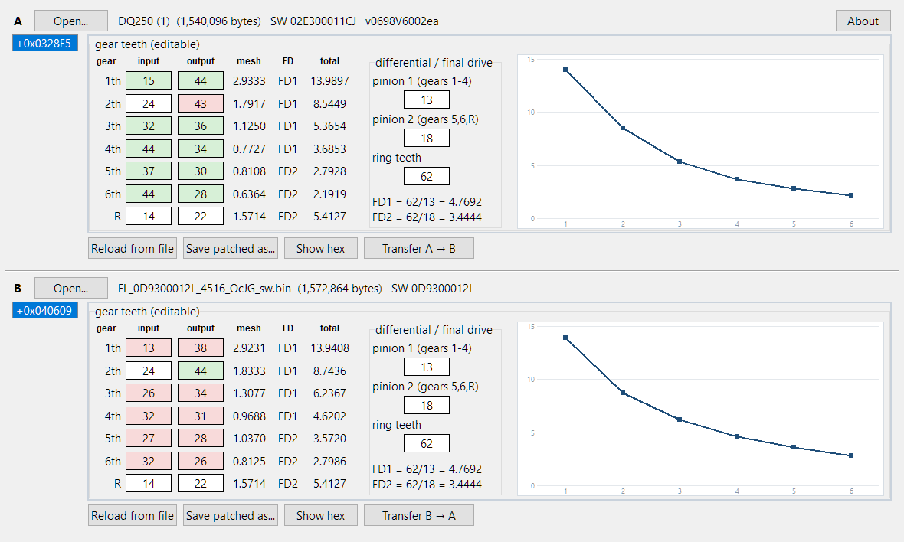

# DQ250 gear editor

Editor for the gear-ratio table inside VAG DQ250 (02E / 0D9) DSG flash dumps.
It finds the 21-byte tooth table, decodes the tooth counts and shows the mesh,
final drive and total ratio per gear live while you edit. Two sides, A and B,
hold two dumps at once, so an original and a modified file - or two different
files - can be compared and values copied between them. Saving always writes a
patched copy and never touches the source dump.



## Run from source

Python 3.9 or newer, no other packages needed for the core app:

```powershell
py -3 dq250_gear_tool.py
```

Drag and drop onto a side needs `tkinterdnd2` (`pip install tkinterdnd2`).
Without it the editor runs normally, only dropping is disabled.

## Command line

```powershell
py -3 dq250_gear_tool.py --test "some_dump.bin"
```

Prints the table it finds, the decoded teeth and every ratio, then re-decodes
the same offset as a round-trip check.

## Build the exe

```powershell
powershell -ExecutionPolicy Bypass -File build.ps1
```

Produces a single-file windowed `dist\dq250_gear_tool.exe` from
`dq250_gear_tool.spec` (PyInstaller). The script also sets the file to Medium
integrity, because a one-file exe unpacks into `%TEMP%` and low-integrity
copies are refused there on locked-down systems.

## Using it

- `Open...` on either side, or drop a dump straight onto the pane.
- The tooth counts are editable; mesh, final drive and total ratio update as
  you type, and the plot redraws.
- The offset cell above the table is editable in place - type a new table
  address and the teeth are re-decoded from there.
- With both sides loaded, fields that differ are tinted green (higher) or red
  (lower) against the other side.
- `Save patched as...` writes a new file and lists every changed byte. The
  checksum is **not** recalculated - fix it with your flashing tool first.

## Licence

MIT, see [LICENSE](LICENSE).

Developed by MHHAUTO - [user lsdlsd88](https://mhhauto.com/User-lsdlsd88).
